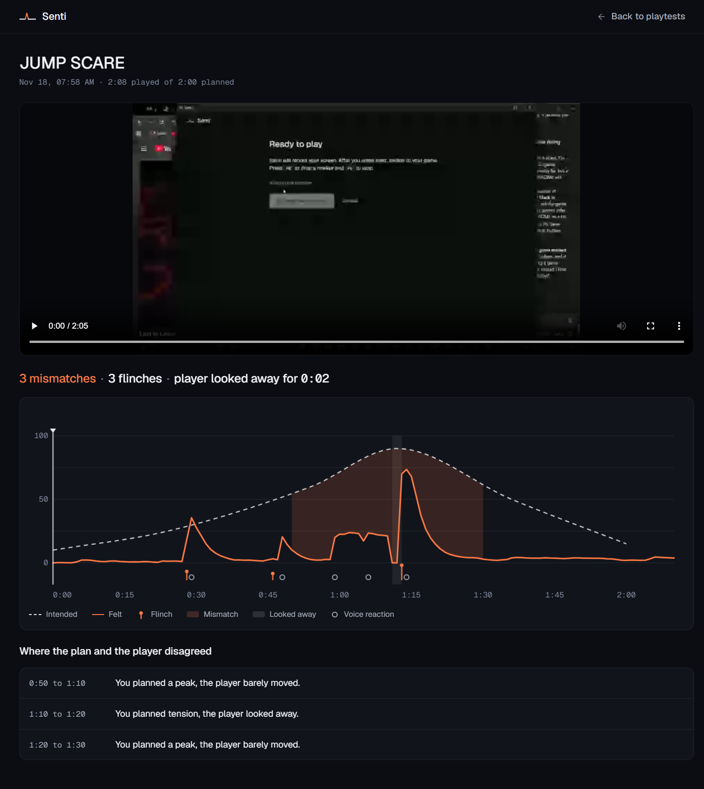
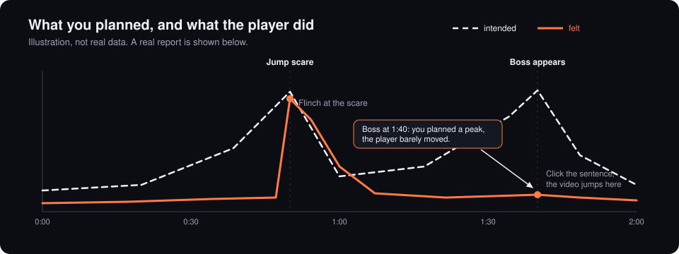
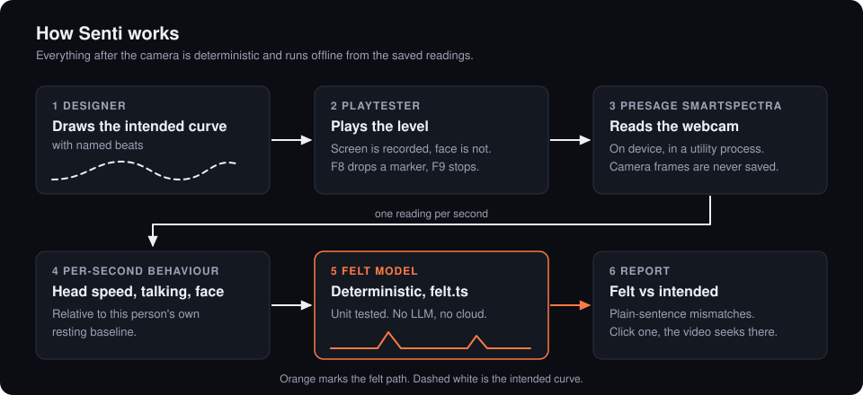
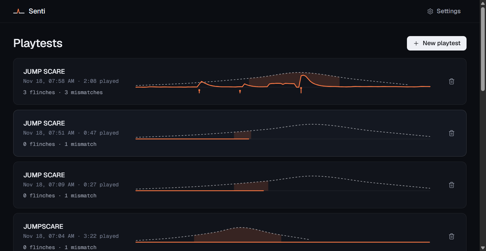
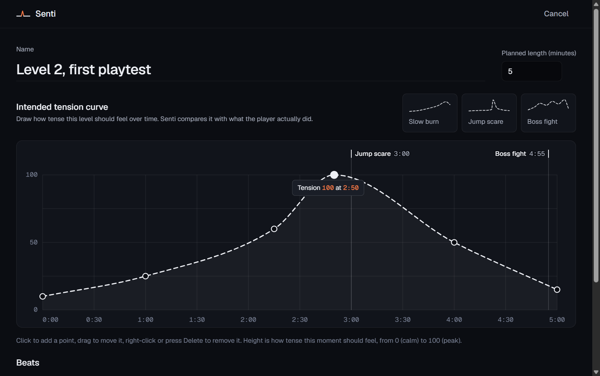
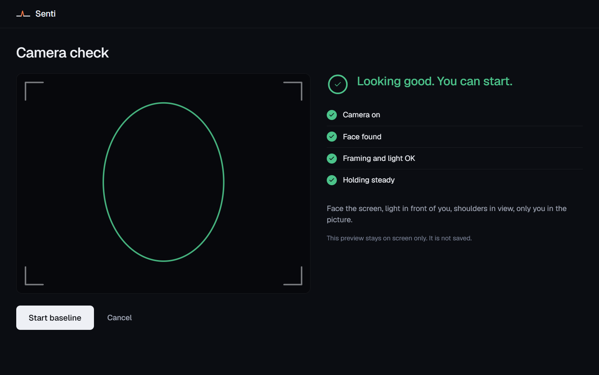

# Senti

**Draw the tension you planned. Watch the tension your player actually felt.** A Windows playtest tool for indie game designers, read live from the webcam with Presage SmartSpectra.

**[Watch the 2.5-minute demo](https://youtu.be/VHjiw6QZF1o)** · **[Download](https://github.com/Techkeyy/senti/releases/latest)** · **[Evidence: real session data](docs/evidence/)** · [Report screenshot](docs/report.png)
<!-- DEV post link goes here -->

[](https://youtu.be/VHjiw6QZF1o)

> *"I built a jump scare. Did anyone actually jump?"*

You plan how a level should feel: calm, then tense, then a scare, then a boss. Then you hand it to a playtester and ask what they thought. They are polite. You end up scrubbing through hours of facecam footage, guessing at the moments that mattered.

Senti is for the designer who runs those playtests. You draw the intended tension curve with named beats, the playtester plays, and the webcam notices what they did: startle head-jerks (I call them flinches), voice reactions, looking away, and a little expression data. The report lays the felt curve over your intended curve and the gameplay recording, flags the mismatches in plain sentences, and clicking one seeks the video to that moment.

<sub>Built for the DEV x Presage SmartSpectra SDK Challenge. Windows x64, one person tested so far, details in the limits below.</sub>

## Try it in 2 minutes

1. Download `Senti-Setup-0.1.0.exe` from [Releases](https://github.com/Techkeyy/senti/releases/latest) and run it. It is unsigned, so on the SmartScreen warning click "More info", then "Run anyway".
2. Paste your free Presage key on the first screen ([get one here](https://physiology.presagetech.com/auth/register)).
3. Click **New playtest**, draw a curve, agree on the consent screen, play something for a minute or two with F9 to stop, and open the report.

If you only want to see a result first: [the report screenshot](docs/report.png), or the saved sessions in [docs/evidence/](docs/evidence/).
No game handy? Open [`demo-level/index.html`](demo-level/) in Chrome: a 2-minute original test level with a scripted thunder crack, a "scary" door that is meant to fall flat, a jump scare and a boss, plus a suggested intended curve to draw.



## Why this exists

Playtest tools today stop at one end or the other. Surveys and interviews capture what players say, which is polite and unreliable. Raw facecam recordings capture everything, so you have to watch all of it. Reaction-reading products exist for streamers and for ads. None of them start from the designer's own plan.

That leaves a gap: nobody lines up what you intended with what happened, second by second, on the same timeline as the gameplay. Presage SmartSpectra makes it reachable on a normal laptop webcam, because it gives per-frame face landmarks and talking detection without any special hardware.



## What it does



1. **Takes your plan.** You name the playtest, draw the intended tension curve, and optionally drop named beats ("jump scare", "boss appears") on it. Output: a saved intended curve.
2. **Asks for consent.** The playtester reads a plain screen about the camera, the screen recording and the data, and agrees. Nothing uses the camera before that.
3. **Checks the camera.** A live check says "face found", "framing and light OK", "holding steady" before Start unlocks. Output: a go/no-go, with a hint when it is not ready.
4. **Takes a resting baseline.** A short rest period learns how still this person normally is, so the thresholds are theirs, not a fixed number. Output: per-person startle threshold. A low-face baseline shows a warning and a Redo button.
5. **Records and reads.** During play Senti records the screen (not the face) and the SDK reports once per second: head speed from face landmarks, talking, face present or lost, expression scores. F8 drops a marker, F9 stops. Output: a per-second reading and a webm.
6. **Builds the felt curve.** A deterministic, unit-tested model in `src/shared/felt.ts`: a startle is a second whose peak head speed exceeds twice the baseline 95th percentile (with a floor); each adds an impulse that decays over 4 s. Talking and fear or surprise add a little. A lost face reads as looking away. No LLM, no cloud.
7. **Compares to your plan.** Windows around each beat and 10 s tiles elsewhere are checked against the intended curve and merged into sentences like "You planned a peak, the player barely moved." Output: the report, with click-to-seek.

Everything in steps 6 and 7 is deterministic and runs offline from the saved readings. The only network use is Presage's own SDK, described under Consent and data handling.

## Quickstart

**To use it (no tooling needed):** install `Senti-Setup-0.1.0.exe` from [Releases](https://github.com/Techkeyy/senti/releases/latest). The installer is unsigned, so Windows SmartScreen warns: click "More info", then "Run anyway". On first launch paste your free Presage key ([get one here](https://physiology.presagetech.com/auth/register)). Create a playtest and go.

**To build it (Node.js, Windows x64):**

```bash
git clone https://github.com/Techkeyy/senti.git
cd senti
npm install

# Put your key in the app's key screen on first launch, or for dev only:
echo "SENTI_PRESAGE_KEY=your-key-here" > probe/.env

npm test            # 11 unit tests, no camera, no key needed
npm run dev         # dev server with hot reload
npm run build       # production build, then: npm run start to preview it
npm run build:win   # NSIS installer into release/
```

Tests and the build need no key and never touch the camera. A real playtest uses the camera and Presage credits (about 1 credit per 30 seconds of sensing).

The unpackaged dev build reads `probe/.env` only when no key is saved in the app. The installed app never reads it.

## Screens

| Home: past playtests as mini curves | Curve editor: beats and a live drag readout | Camera check |
|---|---|---|
|  |  |  |

The camera check image is rendered with Senti's dev screen switcher, so the preview frame is empty. The report and home images show real saved sessions from my laptop.

## Evidence

| Check | Result |
|---|---|
| Pre-registered startle test (rule written before the run) | 11 spike events during jump scares vs 1 in calm, counted above the calm 99th percentile (1.03 face-widths/s). One person, one session. Real trace: [`startle-trace.json`](src/shared/__fixtures__/startle-trace.json), asserted by a unit test |
| [Owner playtest, 17 Nov](docs/evidence/20261117203123-oz9aau.json) | Face present 136 of 136 s at 29.8 readings/s, 0 restarts, 8 flinches, 3 mismatches |
| [Fresh-install playtest, 18 Nov](docs/evidence/20261118070014-j6ow1o.json) (installer, empty state) | Face present 128 of 130 s, 0 restarts, 3 flinches, 3 mismatches, 2 s look-away |
| Unit tests | 11 passing (`npm test`), including the real startle trace |

**Check it yourself:** the two files in [`docs/evidence/`](docs/evidence/) are the real session exports (no camera frames, no video). Count `samples[].face` for face seconds, look at `samples[].headSpeedMax` against the startle rule in `src/shared/felt.ts`, or run `npm test` for the model. Flinches and mismatches come from running `computeReport` on those files.

These are small samples from one person on one laptop. They show the pipeline works end to end on real signals. They are not a validation of the felt curve against what people actually feel.

## Architecture

| Module | Job |
|---|---|
| `src/main/index.ts` | App window, single instance, close confirmation, wires the other modules |
| `src/main/sensing.ts` | Forks the sensing worker and relays commands and events to the renderer |
| `src/main/sensing-worker.ts` | Runs the SDK in a utility process: per-second readings, rebuild on error, idle pause |
| `src/main/sensing-protocol.ts` | Message types between the controller and the worker |
| `src/main/rebuild-budget.ts` | Stops the rebuild loop after more than 6 rebuilds in 2 minutes |
| `src/main/sessions.ts` | Saves, lists and deletes sessions; serves video with range requests; F8/F9 hotkeys |
| `src/main/recorder.ts` | Grants the primary screen for recording; minimizes and restores the window |
| `src/main/settings.ts` | Stores the Presage key, encrypted with Windows via Electron safeStorage |
| `src/main/dev.ts` | Developer tooling: self-test flags, off for normal users |
| `src/shared/felt.ts` | Pure felt-curve model and mismatch finder, unit tested |
| `src/shared/session.ts`, `ipc.ts` | Shared types and IPC channel names |
| `src/preload/index.ts` | The only bridge from the page to the main process |
| `src/renderer/src/App.tsx` | Chooses the screen: key, home, new playtest, run, report, settings |
| `src/renderer/src/screens1.tsx` | Key screen, settings, home list with delete, new playtest form |
| `src/renderer/src/CurveEditor.tsx` | Draw the intended curve; drag, keyboard and beat flags |
| `src/renderer/src/RunFlow.tsx` | Consent, camera check, baseline, play, save |
| `src/renderer/src/useRecorder.ts` | Screen recording at 640x360, 5 fps, waits for the first data |
| `src/renderer/src/Report.tsx` | Video, timeline, mismatch list, click to seek |
| `src/renderer/src/Timeline.tsx`, `LiveTrace.tsx`, `FlinchMark.tsx` | Report and live charts and the flinch mark |
| `src/renderer/src/Shell.tsx`, `ExampleLine.tsx` | App frame and header; the example curve on the empty home screen |
| `src/renderer/src/ErrorBoundary.tsx` | Shows a recovery screen instead of a blank window |
| `src/renderer/src/dev.ts`, `devSim.ts`, `src/renderer/shots.mjs` | Developer tooling: renderer self-tests, a dev screen switcher with simulated data, and the script that took the screenshots in `docs/` |
| `probe/` | The feasibility probes and the pre-registered startle test, see [`probe/README.md`](probe/README.md) |
| `docs/` | Screenshots, the two diagrams, and `evidence/` session exports |

## Why behaviour, not "emotions"

I tried the obvious route first: build the curve from facial expressions. On my face and lighting the expression scores sat at about 60% "surprise" at rest and did not separate calm from tense, so I wrote a test with the pass rule fixed in advance and changed the approach. Senti reads behaviour relative to the player's own baseline: how fast the head moves, whether they talk, whether the face is gone. It never claims to know what someone feels. It reports when they flinched, spoke or looked away, and lets the designer judge.

That is also the lane I think matters: a tool that is honest about what a webcam can see, aimed at the one person who has to act on it, the designer.

## How I tried to break it

| Input | What happens now | Backed by |
|---|---|---|
| Clear startle at a planned peak | No mismatch | unit test |
| Planned peak, player barely moved | Mismatch with the beat label in a plain sentence | unit test |
| Unplanned spike in a calm stretch | Flagged as an unplanned reaction | unit test |
| Face lost during a planned peak | Reported as looking away, not as a missed peak | unit test |
| Empty baseline | Falls back to the first 20 s of play | unit test |
| No samples at all | Empty report, no crash | unit test |
| Same input twice | Identical report | unit test |
| Adjacent windows of one kind | Merged into one sentence | unit test |
| Real startle trace (pre-registered test) | At least 3 startles in tense, at most 1 in calm | unit test on the recorded trace |
| SDK keeps failing and rebuilding | Stops after more than 6 rebuilds in 2 minutes and says so | unit test |
| Presage credits used up (`kCreditExhausted`) | Plain message, no rebuild loop (before: 15 rebuilds in 55 s) | recorded run, state=error, 0 restarts |
| Low frame rate while a video plays and the screen records | Worker runs at high OS priority: 30.0 readings/s for 90 s, 0 restarts | recorded probe run, then the 18 Nov playtest |
| Seeking the video drops a range request | Capped 4 MB reads, always 206; seeked 3 times with the app still running | recorded run over the debugging port |
| Recording a window covered by another window | Records the whole primary screen instead (a covered window gave about 4 frames in 5 s) | measured, then redesigned |
| Camera busy or Windows camera privacy off | Says the camera is in use by another app | handled in code, not yet exercised live in the app |
| No face during baseline | Warning and a Redo button, Ready gated on sensing running | handled in code, not yet exercised live |
| Cancel while the recorder is starting; Retry then Cancel | In-flight guards and an abortable recorder, shared stop promise | handled in code, not yet exercised live |
| Sensing worker crashes mid-play | Worker sends results before teardown, renderer fallback plus notice | handled in code, not yet exercised live |
| Idle for 5 minutes outside play | Sensing pauses to save credits, Retry resumes | handled in code, not yet exercised live |
| Freezing (sitting very still) | Deliberately not reported: a calm player is not reacting | design choice, in `felt.ts` |
| More than one face in view | Not supported; Senti asks for one person only | known limit |

**A missing face never reads as calm: it is reported as looking away.** Rules decide everything the report says; there is no model guessing and no LLM.

## What I learned building on SmartSpectra

I used `@smartspectra/node-sdk` 3.5.0 (the Node/Electron binding) with the SDK's own native camera, face-only metrics, and a rebuild-on-error loop. These are the things I hit, written down in case they save someone else the time. I did not file any issues; issue #19 already describes the exposure one.

- **`reset()` blocks forever after `kTimestampGap`.** It blocks the Node event loop. Senti destroys the SDK instance and builds a new one instead, and never calls `reset()`.
- **The renderer SDK locks exposure to manual and never restores it** ([issue #19](https://github.com/Presage-Security/SmartSpectra/issues/19)). The camera froze dark. Senti runs the native camera in a utility process instead.
- **A registered `videoOutput` listener cut face processing from about 28 to about 5 fps** on a 2-core laptop. Senti listens only during the camera check and removes it before play.
- **The SDK stops itself below about 25 fps (`kSustainedLowFrameRate`).** On a 2-core laptop with a video playing and the screen recording, it did. Running the sensing worker at high OS priority held 30 fps. The recording is 640x360 at 5 fps by design for the same reason.
- **Credits: 1 per 30 s once metrics start**, per Presage. A rebuild starts a new metrics stream. When credits run out the SDK reports `kCreditExhausted` on every start; Senti now shows that plainly and stops instead of looping.
- **Packaging:** the native DLL cannot load from inside `app.asar`. Senti unpacks it with `asarUnpack` and points the SDK at it with `SMARTSPECTRA_CAPI_PATH`.

## Consent and data handling

- **Camera:** used only after the playtester agrees on the consent screen. Only one person should be in view.
- **Camera frames are never saved or uploaded.** The only picture of the face is the live preview on the camera-check screen, which stays on screen. During play only the screen is recorded.
- **Where data lives:** `%APPDATA%\senti\sessions\<id>\` holds `session.json` (intended curve, beats, per-second readings, baseline, timings) and `gameplay.webm`. Everything stays on the computer until you press Stop and save, and nothing is sent anywhere by Senti.
- **Deletion:** the trash icon on Home deletes the whole session folder after a confirm. Senti keeps nothing beyond what you keep.
- **API key:** encrypted with Windows using Electron `safeStorage`, kept in the app's user data folder, never logged and never shown back. Settings can remove it.
- **Telemetry:** the SDK's own telemetry is off (`enableTelemetry: false`).
- **What Presage sees:** the SDK contacts Presage to check the key and usage. Per Presage's documentation it may also send short derived number summaries (never video) for an LLM wellness feature that apps cannot switch off. Senti does not request, show or store those insights.
- **AI use:** Senti calls no other AI service, and the felt curve and report text come from fixed rules.
- **Not a medical device.** Senti makes no health claims. It reports head movement, talking and whether a face is visible.

## Developer notes

The files marked developer tooling above are kept on purpose and do nothing in the installed app. The decisions and test results that matter are in the Evidence, Why behaviour and How I tried to break it sections above, and every change is in the commit history.

## Honest limits

- Windows x64 only.
- Tested by one person (me), on one 2017 laptop (2 cores). It runs there thanks to the priority fix, but close heavy apps. A second tester is not done yet.
- The installer is unsigned, so SmartScreen warns.
- Each user brings their own free Presage key. A session uses about 1 credit per 30 seconds.
- The recording is 640x360 at 5 fps, for performance; it is enough to find the moment, not for fine visual review.
- One face in view only.
- The felt model is frozen and its thresholds were tuned on one person. It has not been validated across players, skin tones or cameras.

## License

Senti's own code is [MIT](LICENSE), copyright 2026 Techkeyy.

**Third-party:** the Presage SmartSpectra SDK is proprietary to Presage and used under Presage's Terms of Service. The installer bundles it, and each user supplies their own key. The SDK ships a `NOTICE` file listing its Apache-licensed components, included by reference at `node_modules/@smartspectra/node-sdk/NOTICE` in a checkout and inside the installed app.
